# 🏢 Awesome Vendor Management System (VMS)

  

  
  
  
  
  
  

---

## 🌟 Introduction & Ecosystem Overview

A **Vendor Management System (VMS)** is an enterprise software application that serves as the central hub for procuring, deploying, managing, and paying an organization's **contingent workforce** and **external service providers**. This includes temporary agency labor, independent contractors, freelancers, and project-based **Statement of Work (SOW)** deliverables.

Modern enterprise VMS solutions automate the entire non-employee lifecycle:
1. **Requisition & Job Broadcast** ➔ Automated requisition drafting, supplier tiering, rate card enforcement, and candidate submission.
2. **Evaluation & Onboarding** ➔ Resume review, automated credential checks, background verification, and identity governance.
3. **Operational Engagement** ➔ Timecards, milestone deliverables, rate compliance, and expense accounting.
4. **Billing & Invoicing** ➔ Consolidated vendor invoicing, purchase order (PO) three-way matching, and ERP financial ledger reconciliation.

Whether you are a **Procurement Leader**, **Contingent Labor Program Manager (MSP)**, **HR Operations Specialist**, or an **Engineering Architect** evaluating whether to build or buy, this repository provides a curated, transparent directory of SaaS market leaders, accurate starting tier pricing, free trial limits, company valuations, and open-source frameworks.

---

## 📑 Table of Contents

- [🏢 Awesome Vendor Management System (VMS)](#-awesome-vendor-management-system-vms)
  - [🌟 Introduction & Ecosystem Overview](#-introduction--ecosystem-overview)
  - [📑 Table of Contents](#-table-of-contents)
  - [📊 Sector Overview & Market Dynamics](#-sector-overview--market-dynamics)
  - [💼 Enterprise SaaS VMS Platforms](#-enterprise-saas-vms-platforms)
  - [💻 Open-Source Projects & Frameworks](#-open-source-projects--frameworks)
    - [🔍 Open-Source Reality in Contingent Workforce VMS](#-open-source-reality-in-contingent-workforce-vms)
  - [🛠️ Core VMS Feature & Capability Matrix](#️-core-vms-feature--capability-matrix)
  - [🤝 How to Contribute](#-how-to-contribute)
  - [📈 Star History](#-star-history)
  - [💖 Support & Community](#-support--community)
  - [📜 Disclaimer & Compliance Notice](#-disclaimer--compliance-notice)

---

## 📊 Sector Overview & Market Dynamics

The global **Vendor Management System (VMS)** and **Contingent Workforce Management (CWM)** software market is estimated at **$10.4 Billion to $12.9 Billion in 2024–2026** and is forecasted to reach **$22.0 Billion to $35.0+ Billion by 2032**, expanding at a compound annual growth rate (CAGR) of **11.2% to 14.8%**. Rapid growth is propelled by escalating enterprise reliance on external technical talent, rigorous global worker classification mandates (IR35, California AB 5), and corporate pushes for unified Statement of Work (SOW) spend transparency.

Market concentration follows a **bifurcated, moderately concentrated structure**:

- **Enterprise Tier (Concentrated Oligopoly)**: The global Fortune 2000 tier is heavily concentrated among three dominant players—**SAP Fieldglass**, **Beeline**, and **Workday VNDLY**—which collectively govern over 65% of global contingent spend programs. These systems boast massive multi-billion-dollar scale, deep two-way ERP integrations (SAP S/4HANA, Workday HCM, Oracle Fusion), and complex supplier clearing networks that create steep defensibility and high switching barriers.
- **Mid-Market & Specialized Segments (Moderately Fragmented)**: The mid-market, shift-heavy scheduling (healthcare, manufacturing, logistics), and third-party risk management (TPRM) verticals display healthy moderate fragmentation. Emerging agile platforms such as **Flextrack** (Salesforce Lightning-native), **VectorVMS** (hybrid Managed Service Provider SMS models), and specialized freelancer governance engines capture rapid market share among companies seeking faster deployment timelines and modular architectures.

---

## 💼 Enterprise SaaS VMS Platforms

The table below catalogs the premier enterprise Vendor Management Systems, sorted in **descending order by company valuation / market scale**.

| 🏢 Platform | 💰 Valuation / Company Scale | 💵 Starting Pricing Tier | 🎁 Free Tier / Trial Limit | 🎯 Key Capabilities & Architecture | 🔗 Official Link |
| :--- | :--- | :--- | :--- | :--- | :--- |
| **SAP Fieldglass** | **~$260.0B Market Cap** *(~€31.2B / $34B ARR, SAP SE)* | **From $35,000/year** base annual subscription (or **0.8% – 1.5%** of managed contingent spend via Pay-As-You-Go model) | **30-day guided sandbox test-drive** (limited to pre-configured demo requisition templates & 5 test worker timesheets; no perpetual free plan) | Industry standard for global contingent labor and SOW services procurement. Deep native integration with SAP S/4HANA Cloud and SuccessFactors, complex multi-tier approval chains, multi-country localization, and automated supplier rate-card compliance. | [SAP Fieldglass](https://help.sap.com/) |
| **Workday VNDLY** | **~$70.0B Market Cap** *(~$7.3B ARR, Workday, Inc.)* | **From $149/month** (Smart Start SMB bundle) or **$25,000/year** enterprise tier (or **1.0% – 2.0%** contingent spend fee) | **14-day guided sandbox evaluation** (limited to 5 job requisitions and 2 test staffing vendors upon sales qualification; no free forever tier) | Cloud-native modern VMS acquired by Workday. Offers unified total-workforce visibility with Workday HCM, AI-assisted candidate matching, automated tenure policy tracking, pay parity compliance, and end-to-end requisition-to-invoicing. | [Workday VNDLY](https://www.workday.com/en-us/products/vndly-vms/vndly-vms-for-hr.html) |
| **Coupa Contingent Workforce** | **$8.0B Valuation** *(~$860M ARR, Thoma Bravo / Coupa)* | **From $25,000/year** base platform subscription (or **1.0% – 1.5%** supplier transaction fee) | **14-day proof-of-concept sandbox** (up to 3 simulated approval hierarchies and 10 mock contractor records; no free forever tier) | Contingent labor module embedded within Coupa Business Spend Management (BSM). Manages client requisitions, supplier broadcasts, candidate submissions, rate benchmarking, timesheet approvals, and purchase order reconciliation. | [Coupa CW](https://docs.coupa.com/) |
| **Magnit** | **$3.5B Valuation** *(~$1.5B ARR, EQT Partners)* | **From $3,500/month** ($42,000/year base) or **1.5% – 2.5%** of managed contingent payroll | **14-day interactive shift sandbox** (up to 50 simulated shifts and 2 sample hospital/warehouse locations; no free forever tier) | Dedicated high-volume shift management VMS built for nurses, production lines, drivers, and retail crews. Capable of generating 1,000 requisitions across 100 locations in 5 minutes with automated no-show re-dispatching. | [Magnit](https://magnitglobal.com/) |
| **Beeline** | **~$1.2B Valuation** *(~$200M ARR, $68B+ spend, New Mountain Capital)* | **From $30,000/year** base annual subscription (or **1.0% – 2.0%** supplier-funded transaction markup) | **30-day Proof-of-Value sandbox pilot** (limited to 1 business department, 20 contractor profiles, and standard analytics; no free tier) | Dedicated enterprise VMS managing over 6.1M contingent workers globally. Provides deep multi-currency and labor-law localization across 120+ countries, milestone-based SOW management, and direct sourcing talent pools. | [Beeline](https://www.beeline.com/solutions/enterprise) |
| **VectorVMS** | **~$1.0B Market Cap** *(£800M+ / ~$750M ARR, LTG plc)* | **From $1,500/month** ($18,000/year base) or **1.25% – 1.75%** of gross contingent spend | **14-day guided sandbox access** (limited to 5 requisitions and 1 custom rate card configuration; no free forever tier) | Tailored for mid-market programs requiring high agility. Features a hybrid Shared Managed Services (SMS) model, Consolidated Invoicing & Payments (CIP), and pre-engagement DOT and credential compliance tracking. | [VectorVMS](https://vectorvms.com/) |
| **Flextrack** | **~$150M Valuation** *(~$35M ARR, Flextrack Inc.)* | **From $2,000/month** ($24,000/year base) via Salesforce AppExchange (or **~1.0%** spend fee) | **14-day AppExchange scratch sandbox** (limited to 1 Salesforce test org and 10 contractor profiles; no free forever tier) | Built natively on Salesforce Lightning platform. Enables drag-and-drop Flow Builder workflow automation, seamless integration with 7,000+ AppExchange applications, and predictive AI analytics for labor rate forecasting. | [Flextrack](https://www.flextrack.com/) |
| **DCR Workforce** | **~$120M Division Scale** *(Acquired by Coupa for ~$100M+)* | **From $2,000/month** ($24,000/year base) or **1.0%** of managed SOW contract value | **14-day guided SOW test sandbox** (up to 3 milestone contracts and 5 candidate profiles; no free forever tier) | Specialized VMS and services procurement solution focused heavily on complex Statement of Work (SOW) enablement, milestone deliverable verification, and Freelancer Management System (FMS) workflows. | [DCR Workforce](https://www.dcrworkforce.com/) |
| **Utmost** | **~$75M Acquisition Scale** *(Raised $30M Series B, acquired by Beeline)* | **From $1,500/month** ($18,000/year base) or **$10/active external worker/month** | **14-day sandbox access upon consultation** (limited to 25 worker profiles and basic worker classification checklist; no free forever tier) | Extended workforce system of record designed to catalog all non-employee talent. Specializes in worker classification risk mitigation (employee vs. contractor), tenure tracking, and real-time HCM sync. | [Utmost](https://www.utmost.co/) |
| **Conrep** | **~$15M Valuation** *(~$4M ARR, Conrep Inc.)* | **$20 – $35/user/month** (Starting at **$200/month** minimum for 10 user seats) | **14-day full-access guided trial** (limited to 5 user seats and 100 candidate resumes; no free forever tier) | Modular staffing and recruiting VMS with front and back-office automation. Features DCAA-compliant accounting workflows required by US federal government contractors and defense suppliers. | [Conrep](https://www.conrep.com/) |

---

## 💻 Open-Source Projects & Frameworks

The table below catalogs active open-source repositories related to **Vendor Management, TPRM (Third-Party Risk Management), Procurement, and Contractor/Gig Operations**, sorted in **descending order by GitHub star count**.

| 📦 Repository & Star Badge | ⭐ Stars | 🛠️ Tech Stack | 📜 License | 🎯 Architectural Role & Capabilities |
| :--- | :--- | :--- | :--- | :--- |
| **[ITFlow](https://github.com/itflow-org/itflow)**  | **1,035+** | PHP, MariaDB, Bootstrap, Docker | GPL-3.0 | All-in-one open-source PSA and management suite for Managed Service Providers (MSPs). Features centralized vendor directory, hardware/software asset tracking, license renewals, ticketing, invoicing, and a dedicated vendor/client portal. |
| **[OpenGRC](https://github.com/LeeMangold/OpenGRC)**  | **156+** | PHP, MySQL, Apache | AGPL-3.0 | Self-hosted enterprise GRC & Third-Party Vendor Risk Management (TPRM) platform. Automates vendor security questionnaires, compliance audits (ISO 27001, SOC 2, NIST CSF, HIPAA), risk registers, and supplier remediation workflows. |
| **[Unicis Platform CE](https://github.com/UnicisTech/unicis-platform-ce)**  | **107+** | TypeScript, React, Node.js, Docker | AGPL-3.0 | Modern open-source alternative to Vanta and Drata for governance, risk, and compliance. Delivers vendor risk assessment modules, third-party data processing agreement audits, and automated security controls monitoring. |
| **[Vendor Risk Tracker](https://github.com/prajwal152004/Vendor_Risk_Tracker)**  | **14+** | Python, Streamlit, Pandas | MIT | Third-Party Vendor Risk Management (TPRM) simulation engine for enterprise risk teams. Evaluates vendor vulnerability scores based on system access privileges, data sensitivity, and organizational criticality. |
| **[LicenseTrack](https://github.com/zndr88/LicenseTrack)**  | **13+** | Python, Flask, SQLite, Bootstrap | MIT | Self-hosted software vendor contract and license management tool. Tracks external vendor contracts, software subscriptions, maintenance renewal schedules, SLA commitments, and recurring expenditures. |
| **[DataRohit Vendor MS](https://github.com/DataRohit/Vendor-Management-System)**  | **2+** | Python, Django, DRF, Celery | MIT | Vendor and purchase order management system featuring JWT token authentication, purchase order lifecycle handling, and automated historical vendor performance metric calculations. |
| **[VendorBridge AI](https://github.com/vatsalgajera-tech/VendorBridge-AI)**  | **1+** | React, Node.js, Express, MongoDB | MIT | AI-assisted procurement ERP managing supplier directories, supplier risk scoring, multi-vendor RFQ bidding, AI quotation comparison, purchase order creation, and invoice tracking. |
| **[Flexzora](https://github.com/SyxNyn3/Flexzora_Gig_Management_Platform)**  | **1+** | React, TypeScript, Supabase, PostgreSQL | MIT | Open-source gig and shift management platform with conflict detection, contractor skill profiling, shift scheduling, gig discovery, and integrated Stripe payment processing. |
| **[KrishnaSankar VMS](https://github.com/krishnasankarkk/vendor-management-system)**  | **1+** | Python, Django REST Framework, SQLite | MIT | Backend service providing RESTful endpoints for vendor profiles, purchase order tracking, and dynamic calculations of On-Time Delivery Rate, Quality Rating Average, and Fulfillment Rates. |
| **[AI-Vendor-Management-System](https://github.com/Ahmed-Mohsen-2005/AI-Vendor-management-system)**  | **1+** | Next.js, FastAPI, Prisma ORM, PyTesseract | MIT | Full-stack vendor management tool featuring automated OCR invoice extraction, purchase order matching, and interactive vendor analytics dashboards with shadcn/ui. |

---

### 🔍 Open-Source Reality in Contingent Workforce VMS

Unlike domains like CRM, ERP, or ITSM where robust open-source alternatives exist (e.g., ERPNext, Odoo, SuiteCRM), **enterprise contingent workforce VMS has virtually zero end-to-end open-source equivalents**. 

**Why does this gap exist?**
1. **Multi-Party Clearinghouse Complexity**: A true VMS coordinates an intricate four-party triangle: the enterprise hiring manager, the corporate procurement/HR team, multiple tier-1/tier-2 staffing suppliers, and individual contingent contractors.
2. **Legal & Co-Employment Risks**: Systems must enforce strict tenure rules (e.g., Microsoft 18-month tenure limits), statutory tax classifications (US 1099 vs. W-2, UK IR35), and global labor laws. Misclassification carries multi-million-dollar tax liabilities.
3. **Consolidated Financial Invoicing**: VMS engines reconcile thousands of contractor timesheets, validate them against pre-negotiated rate cards with overtime/shift differentials, generate a single consolidated monthly bill for the client, and disburse remittances to dozens of staffing vendors.

**Recommended Architectural Strategy**:
If your engineering team aims to assemble an internal solution, combine **ITFlow** or **VendorBridge AI** for supplier records and procurement approvals, integrate **Flexzora** for shift and contractor calendar scheduling, and bind them with an enterprise identity provider (Okta, Keycloak) and an ERP accounting engine. For full-scale enterprise programs, commercial SaaS platforms remain indispensable.

---

## 🛠️ Core VMS Feature & Capability Matrix

| Feature Domain | 🏢 Enterprise SaaS (VNDLY, Fieldglass, Beeline) | 💻 Open-Source Ecosystem (ITFlow, OpenGRC, Flexzora) |
| :--- | :--- | :--- |
| **Requisition Distribution** | ✅ Automated tier-based broadcast to 100+ staffing agencies | ⚠️ Manual RFQ creation or single supplier assignment |
| **Candidate Sourcing & Screening** | ✅ Candidate deduplication, AI resume matching, rate checks | ❌ Handled externally or via generic file attachments |
| **Rate Card & Markup Compliance** | ✅ Strict enforcement of negotiated rate cards & margin caps | ⚠️ Static rate fields without automated validation |
| **Timesheets & Milestones** | ✅ Multi-tier timesheet approvals, shift differentials, SOW milestones | ⚠️ Basic task tracking, calendar shifts, or manual hours log |
| **Consolidated Invoicing** | ✅ Automated 3-way PO matching, consolidated vendor billing | ⚠️ Single vendor invoice recording; no consolidated clearing |
| **Tenure & Co-Employment Governance** | ✅ Automated policy triggers (e.g., max tenure alerts, pay parity) | ❌ Requires custom workflow scripting |
| **ERP / HCM Integrations** | ✅ Certified connectors for SAP, Workday, Oracle, Coupa | ⚠️ Custom REST APIs / webhook integrations |

---

## 🤝 How to Contribute

Contributions from the contingent workforce, HR technology, and open-source software communities are warmly encouraged!

1. 🍴 **Fork the repository** on GitHub.
2. 🌿 **Create a dedicated topic branch** (`git checkout -b feature/add-new-vms-tool`).
3. 📝 **Edit `README.md`** following the established format:
   - Include exact starting pricing (no generic "Contact Sales" or "Usage-based").
   - Include specific free trial days and resource limitations (no "N/A" or "None").
   - Include company valuation / revenue metrics.
   - For open-source repos, include the shields.io social star badge linking to the `/stargazers` page.
4. 🧪 **Validate table formatting and markdown links**.
5. 🚀 **Submit a Pull Request** with a concise summary of your additions.

---

## 📈 Star History

---

## 💖 Support & Community

Thank you for visiting and supporting this curated catalog! If you found this directory valuable for your workforce planning, procurement research, or software evaluation:

- ⭐ **Star this repository** to bookmark it and help others discover it.
- 🍴 **Fork this repository** to propose new SaaS platforms or open-source additions.
- 📢 **Share this guide** on LinkedIn, X, or with your HR operations and procurement colleagues.
- ☕ **Support the maintainer**: Buy a coffee or sponsor ongoing open-source curation via the [GitHub Sponsors Dashboard](https://github.com/sponsors/ishandutta2007).

---

## 📜 Disclaimer & Compliance Notice

- This repository is a **community-curated research directory** provided for educational and architectural evaluation purposes.
- Mentions of commercial SaaS platforms or open-source projects do not constitute formal endorsements.
- Managing contingent workers, freelance talent, and staffing vendor contracts involves strict compliance with federal, state, and international labor standards (such as worker classification laws, joint-employer liability, GDPR/data sovereignty, and tax withholdings). Always consult qualified legal and procurement counsel when designing enterprise contingent workforce workflows.
- All product names, trademarks, and registered trademarks belong to their respective corporate owners.
